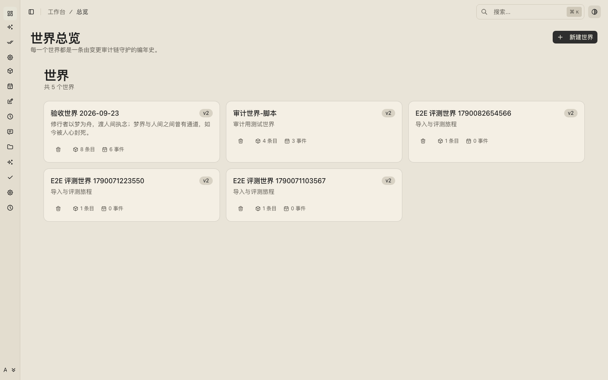
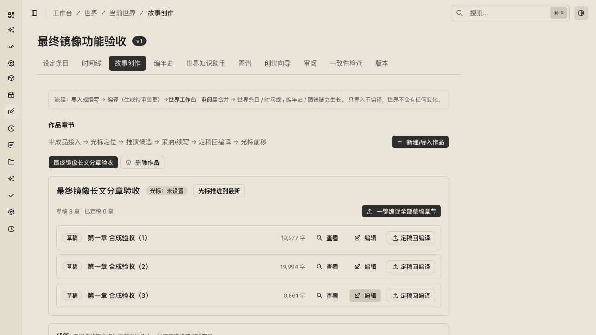
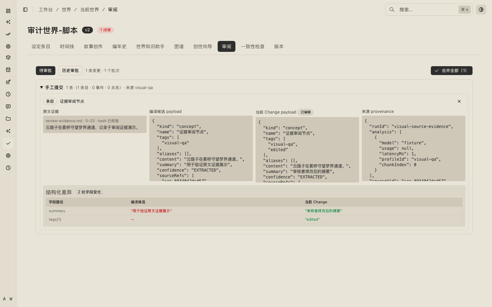
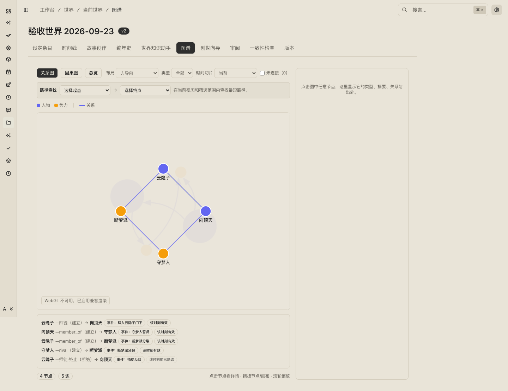

# WorldLoom · 世界观与编年史创作工作室

把小说或设定稿整理成可追溯的世界。你可以从一章原文出发，审阅模型提取的人物、事件与关系，再把认可的内容收入正史。之后写下一章时，可以沿时间线查旧事，也可以让助手带着出处回答问题。

本指南面向 **本机单人使用**。当前源码版本为 `0.1.0`。可在工作室的 `/api/health/live` 查看运行版本，正式发布状态见 [GitHub Releases](https://github.com/betterkite/WorldLoom/releases)。[v0.1 实测结果与已知限制](docs/V0_1_RELEASE.md)

## 1 · 启动工作室

首次安装，准备好已启动的 Docker Desktop（或带 Compose 的 Docker Engine）。解压产品源码包或用 Git 克隆项目后，进入含有本指南的目录。已有作品请先保存数据库备份，在新库里读回一章文稿后再升级。[备份与试恢复](docs/BACKUP_RESTORE.md) · [本机升级说明](docs/LOCAL_DEPLOYMENT.md)

```sh
# 首次创建本机配置，保留已有配置
test -f .env.local || (umask 077 && cp .env.example .env.local)
```

用文本编辑器打开 `.env.local`，在 `DEEPSEEK_API_KEY=` 后填入自己的密钥。编译、问答和推演会使用 DeepSeek；导入和查看原稿可先体验。内存有限时，把文件里的 `WORLDLOOM_WORKER_MAX_CONCURRENCY` 设为 `1`，让后台任务排队处理。

```sh
docker compose --env-file .env.local --profile full up -d --build
docker compose --env-file .env.local --profile full ps -a
```

首次启动需要构建镜像。等一次性迁移服务 `migrate` 显示 `Exited (0)`，应用和数据库就绪后，打开 [本机工作室](http://127.0.0.1:4310)。日常关闭用 `docker compose --env-file .env.local --profile full stop`，下次用同一命令把 `stop` 换成 `up -d`。创作数据保存在数据库卷中。

## 2 · 新建一个世界

进入 **世界列表 → 新建世界**。示例名称填「雾港」，一句话前提填「守灯人和学徒照看着一座常年起雾的渡口」。选择 **review（逐条审阅）**，点击 **创建**，再进入世界。如果窗口较窄，可以用左上角的侧栏按钮展开导航。



## 3 · 从前端导入两章稿件

下载[原创示例《雾港夜渡》](docs/guide/fog-harbor.txt)（打开文件后选择 **Download raw file**），或准备自己的 TXT、Markdown、PDF、EPUB 文件。

1. 在世界中打开 **故事创作 → 新建/导入作品**。选择文件，确认作品名和提取出的正文，点击 **创建**。
2. 选择刚创建的作品。示例应显示「第一章 雾起时」和「第二章 最后一班渡船」两行。点击第二行的 **查看**，最后一句应以「却没有打开它。」收尾。
3. 如需改稿，在该章点击 **编辑** 并保存。长文按章标题或分隔线拆分，过长章节会继续切片。先检查目录和首尾，再选择要编译的章节。[长文导入说明](docs/LARGE_MANUSCRIPTS.md)



## 4 · 让一章进入正史

在第一章右侧点击 **定稿回编译**。后台完成后进入 **审阅 → 待审批**，展开一条候选，左右对照原文和变更字段。以示例为例，原文明确叶澄是阿岑的师父、钥匙交给了阿岑；锁门人的身份仍是未知。遇到模型替你填上锁门人姓名的候选，可点击 **弃用**。

**合并全部** 会处理当前待审队列里的所有变更。先逐条检查，弃用不希望保留的项目，再合并。页头应显示新的版本号；在 **版本** 页可以查看历史。回滚会追加一个版本，之前的记录仍可追溯。



## 5 · 用已合并的设定继续写

| 想做什么 | 在哪里操作 | 可以核对什么 |
| --- | --- | --- |
| 查一个事实 | **世界知识助手**，问「谁把铜钥匙交给了阿岑？」 | 对照答案的引用。再问「谁锁了油库？」，观察助手是否指出证据不足 |
| 看前因后果 | 编译并审阅第二章后，打开 **编年史** 或 **时间线** | 对照灯亮、渡船靠岸的先后顺序 |
| 看人物关系 | **图谱 → 关系图**，点击人物节点 | 核对相连人物，在侧栏查看节点详情；切换事件时刻可查看关系变化 |
| 接着写一章 | **故事创作** 中选定作品与进度光标，生成推演候选 | 如需保留，点 **采纳** 后再审阅；留意未打开的木匣能否承接上一章 |
| 检查设定冲突 | **一致性检查**，对当前主版本运行检查 | 查看发现项，回到相应条目修订，再合并一个新版本 |



## 6 · 导出你的世界

在浏览器地址栏找到当前世界地址中的 ID，例如 `/dashboard/worlds/<世界ID>/story` 中间的那一段。在同一台电脑打开下面的地址，将 `<世界ID>` 换成实际值。

| 格式 | 浏览器地址 | 使用方法 |
| --- | --- | --- |
| Obsidian ZIP | `http://127.0.0.1:4310/api/worlds/<世界ID>/export` | 解压到新文件夹，用 Obsidian 打开，阅读条目与时间线 |
| 游戏引擎 JSON | `http://127.0.0.1:4310/api/worlds/<世界ID>/export/json?download=1` | 下载结构化的主版本数据，供工具读取 |

导出反映当前已合并的主版本。要保留草稿、任务、用量和完整历史，请按[数据库备份与恢复指南](docs/BACKUP_RESTORE.md)备份。[Obsidian 文件与链接规则](docs/OBSIDIAN_EXPORT.md)

## 使用中遇到问题

| 现象 | 下一步 |
| --- | --- |
| 页面打不开，或刷新后仍像旧版 | 打开[进程状态](http://127.0.0.1:4310/api/health/live)看版本，再看[数据库就绪状态](http://127.0.0.1:4310/api/health/ready)。确认浏览器指向本次安装的 4310 端口 |
| 导入成功，编译一直排队 | 查看 Compose 状态里的 worker 和 migrate，再到 **运行健康** 查看任务状态。[取消与恢复说明](docs/COMPILE_RUNS.md) |
| 远程 embedding 返回 402 | 可以继续用词法检索。要使用本地语义检索，在产品目录用 Node 24、pnpm 11.22.0 先执行 `pnpm install --frozen-lockfile`，再用 `pnpm embeddings:download` 下载 BGE-M3，再在运行概览重建索引。Compose 会将模型缓存挂载给 app 和 worker |
| 想知道模型用了多少 | 回到 **世界列表**，在 **累计模型用量** 卡片查看调用次数和 token。个人模式默认不限消费额，部分调用可能缺少用量数据。[用量口径](docs/LLM_USAGE.md) |

**进阶入口**　[世界治理和架构](docs/PROJECT_REVIEW.md) · [评测平台](docs/EVALUATIONS.md) · [MCP 与开发入口](docs/HANDOFF.md) · [工程验收](docs/ACCEPTANCE.md) · [恢复旧版本](docs/ROLLBACK_RECOVERY.md) · [部署设置](docs/DEPLOYMENT_SECURITY.md)

WorldLoom 使用 [MIT 许可证](LICENSE)。字体、模型和依赖的许可见[第三方声明](THIRD_PARTY_NOTICES.md)。
